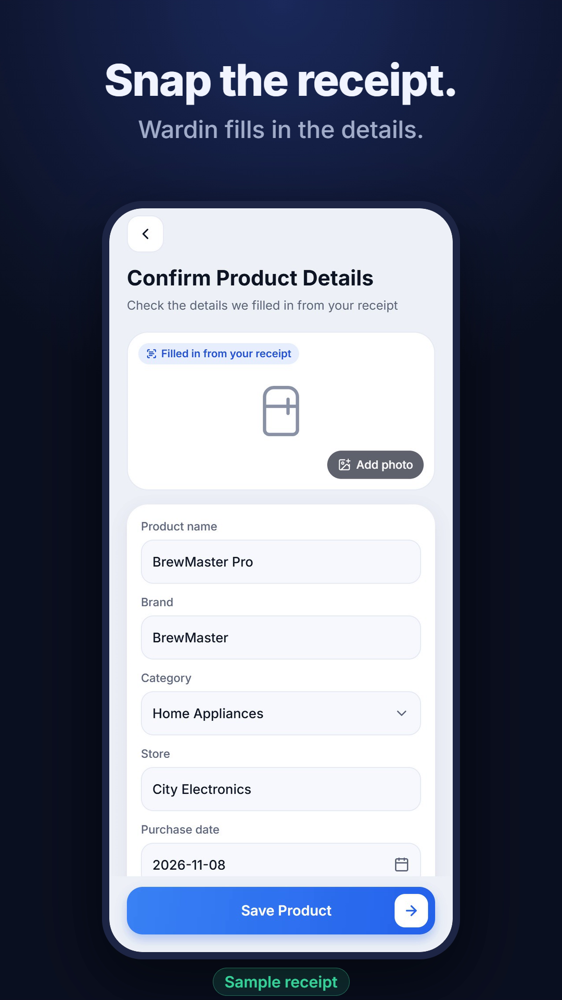
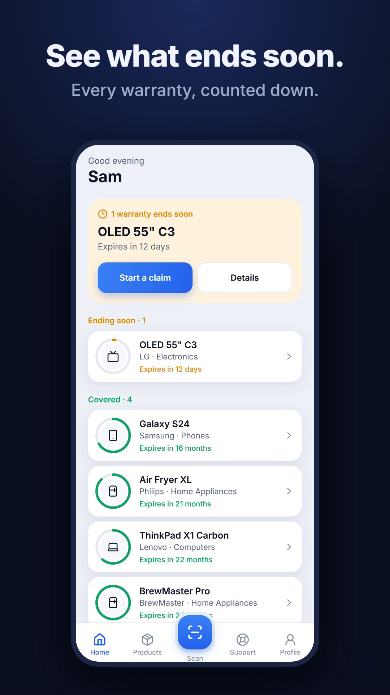
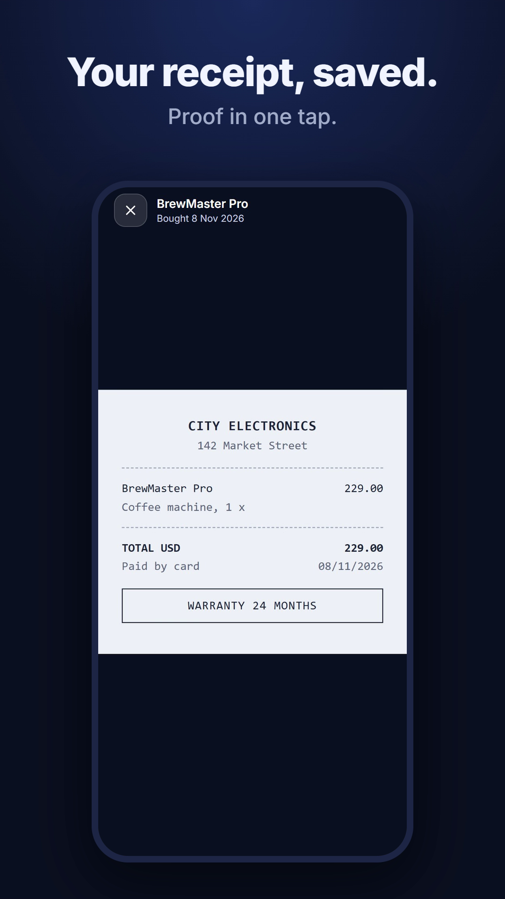
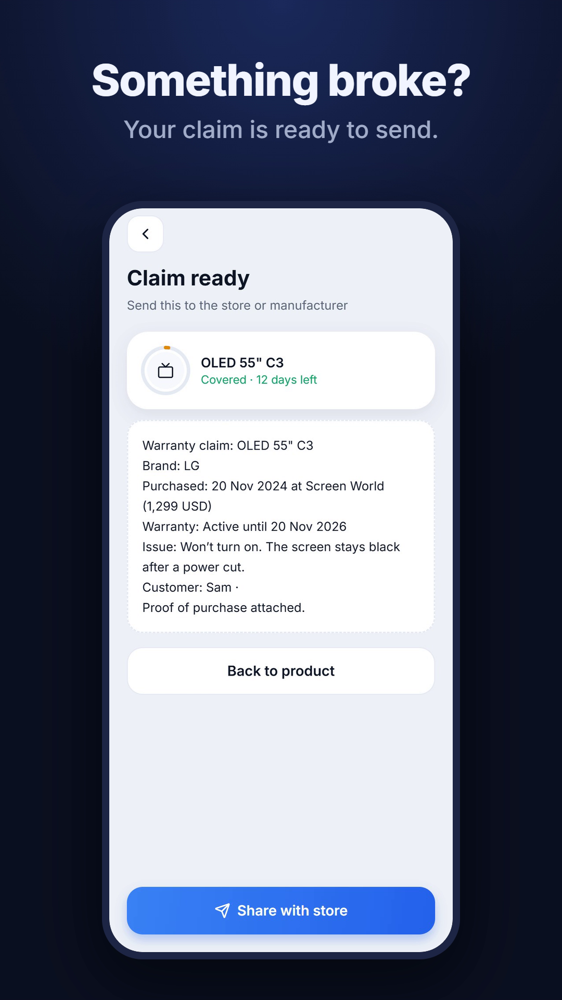

# Wardin: know how long you're covered

Wardin is a free warranty tracker. Photograph a receipt and Wardin fills in the product, store, date, price and warranty. Then it counts the warranty down, reminds you before it ends, and keeps the receipt photo as proof.

  
  
  
  

## Download

| | |
|---|---|
| **Android** | Download the `.apk` file from the [latest release](https://github.com/ahmedi56/wardin-app/releases/latest) |
| **iPhone and computers** | Use the browser version: [warranty-9ze.pages.dev/get](https://warranty-9ze.pages.dev/get/) |

Wardin is free. There are no ads and no in-app purchases.

## What it does

- **Reads your receipt.** Take a photo and the details are filled in for you. You check them before saving, or type them by hand.
- **Counts down every warranty.** See at a glance what ends soon and what is still covered.
- **Reminds you before it ends.** Pick when you want to be reminded. Reminders run on your phone (Android app).
- **Keeps the receipt.** The photo is saved with the product. Tap it to open it full screen or share it.
- **Helps with claims.** If something breaks, Wardin writes a short claim summary you can send to the store or the manufacturer.
- **Works in your currency.** Choose from 30 currencies.

## Installing on Android

Wardin is not on Google Play yet, so Android installs it from the downloaded file:

1. Open the [latest release](https://github.com/ahmedi56/wardin-app/releases/latest) on your phone and tap the `.apk` file under **Assets**.
2. Open the downloaded file. If Android asks, allow your browser to install apps.
3. Tap **Install**. A newer version installs over an older one and keeps your data.

Android shows this extra step for any app that doesn't come from the Play Store. It's not a sign of a problem with the app.

## Your data

- Without an account, everything stays on your phone.
- If you sign in (with an email code), your products and receipts are backed up to your private account.
- Receipt photos are read by Google's Gemini service. You can always enter the details by hand instead.
- No ads, no tracking, and your data is never sold.

Read the full [privacy policy](https://warranty-9ze.pages.dev/privacy/) and [terms of use](https://warranty-9ze.pages.dev/terms/).

## Status

Wardin is an early version, built by one developer. Feedback, bug reports and ideas are very welcome: open an [issue](https://github.com/ahmedi56/wardin-app/issues) or write to **wardin.support@gmail.com**.

Made by Wardin Studio, Tunisia.
