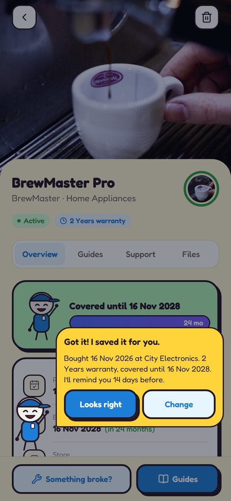
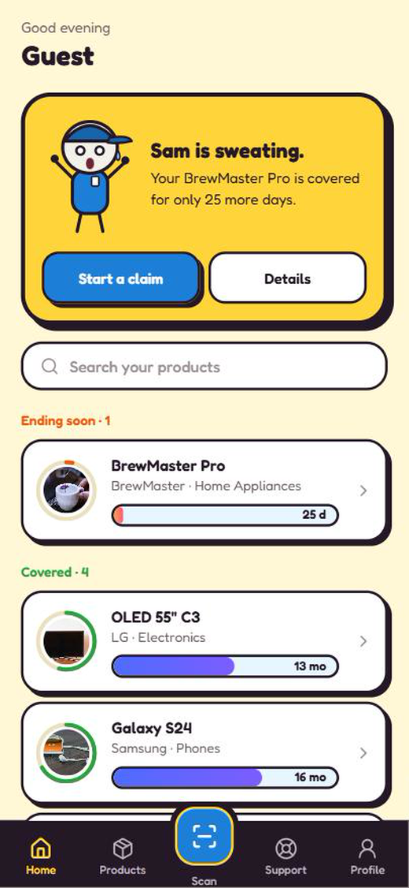
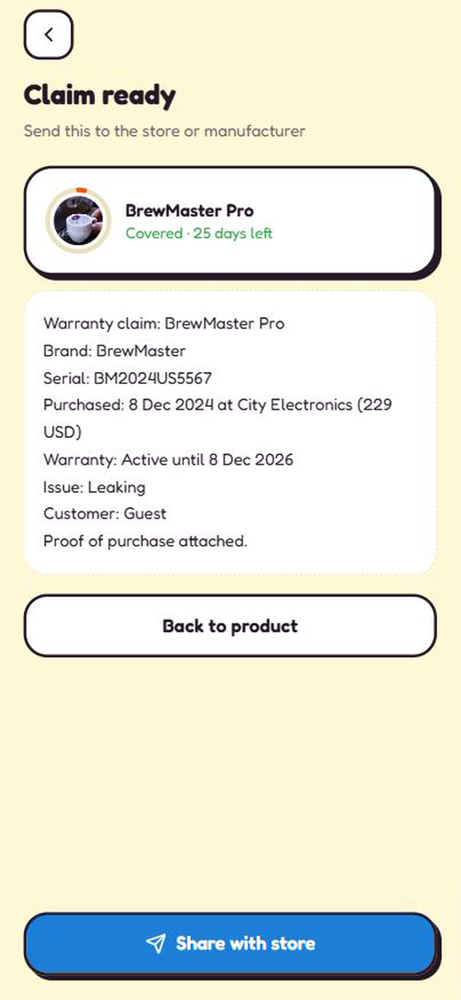
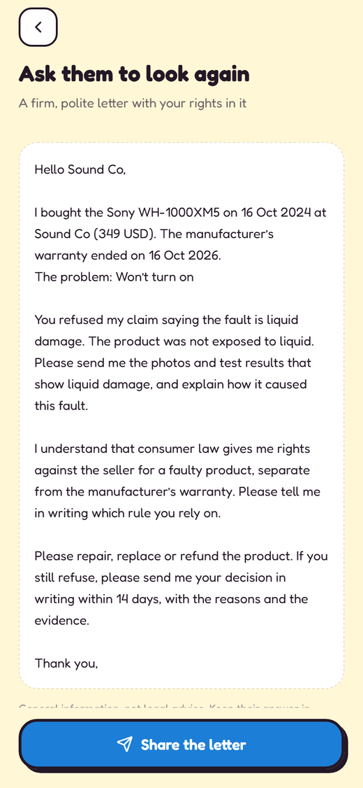

# Wardin: know how long you're covered

Wardin is a free warranty tracker. Photograph a receipt and Sam, Wardin's helper, saves the product, store, date, price and warranty for you. No form to fill in. Then he counts the warranty down, reminds you before it ends, and helps you claim when something breaks.

  
  
  
  

**1. Snap it, Sam saves it** &nbsp;·&nbsp; **2. Sam watches it** &nbsp;·&nbsp; **3. Something broke? Claim it** &nbsp;·&nbsp; **4. Refused? Ask again**

## Download

| | |
|---|---|
| **Android** | Download the `.apk` file from the [latest release](https://github.com/ahmedi56/wardin-app/releases/latest) |
| **iPhone and computers** | Use the browser version: [warranty-9ze.pages.dev/get](https://warranty-9ze.pages.dev/get/) |

Wardin is free. There are no ads and no in-app purchases.

## What it does

- **Snap and forget.** Take a photo of the receipt and Sam saves it. He pops up to tell you what he saved: tap **Looks right**, or **Change** to fix the date or warranty length. You can still type everything by hand.
- **Counts down every warranty.** See at a glance what ends soon and what is still covered.
- **Reminds you before it ends.** Pick when you want to be reminded. A few days after it ends, Sam reminds you once more: the seller may still owe you a repair or refund by law. Reminders run on your phone (Android app).
- **Keeps the receipt.** The photo is saved with the product. Tap it to open it full screen or share it.
- **Helps with claims.** If something breaks, Wardin writes a short claim summary you can send to the store or the manufacturer.
- **Claim refused?** Pick what the store said (water damage, no receipt, warranty ended...) and Wardin writes a firm, polite letter with your rights for your country (EU, UK, US, Australia).
- **Serial numbers and search.** Save the serial number, then find any product by name, store, date or serial.
- **Backup and restore.** Export your list, and paste it back to restore it.
- **Works in your currency.** Choose from 30 currencies.

## Installing on Android

Wardin is not on Google Play yet, so Android installs it from the downloaded file:

1. Open the [latest release](https://github.com/ahmedi56/wardin-app/releases/latest) on your phone and tap the `.apk` file under **Assets**.
2. Open the downloaded file. If Android asks, allow your browser to install apps.
3. Tap **Install**. A newer version installs over an older one and keeps your data.

Android shows this extra step for any app that doesn't come from the Play Store. It's not a sign of a problem with the app.

## Your data

- Without an account, everything stays on your phone.
- If you sign in (with an email code), your products and receipts are backed up to your private account.
- Receipt photos are read by Google's Gemini service. You can always enter the details by hand instead.
- No ads, no tracking, and your data is never sold.

Read the full [privacy policy](https://warranty-9ze.pages.dev/privacy/) and [terms of use](https://warranty-9ze.pages.dev/terms/).

## Status

Wardin is an early version, built by one developer. Feedback, bug reports and ideas are very welcome: open an [issue](https://github.com/ahmedi56/wardin-app/issues) or write to **wardin.support@gmail.com**.

Free web tool, no install: [check if a warranty is still valid](https://warranty-9ze.pages.dev/check/).

Made by Wardin Studio, Tunisia.
